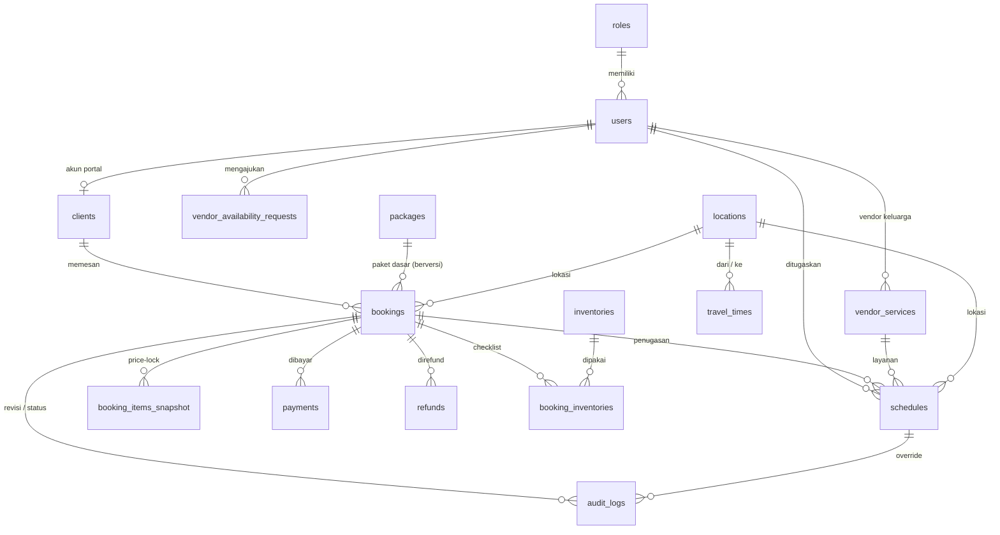

# Fase 1 — Skema Database Yeni Wedding

Laravel 13 · PHP 8.3 · MySQL 8. Status/tipe disimpan sebagai `string` + PHP Enum (`app/Enums`) agar portabel (MySQL & SQLite untuk test).

## ERD



## Tabel & aturan bisnis

| Tabel | Isi utama | Aturan |
|---|---|---|
| `roles`, `users` | 4 peran; `users.jabatan` (mua, asisten_rias, dekorator, kru_dekorasi), `phone` WA | RBAC |
| `clients` | Data pasangan & kontak, opsional tertaut akun klien | Portal klien |
| `packages` | `kode` + `versi` unik, `harga_dasar`, masa berlaku | AB-05 paket berversi |
| `dynamic_components` | `tipe_harga` flat / per_unit / per_cm (tenda = `harga_satuan × ukuran_cm`) | AB-05 komponen berfluktuasi |
| `vendor_services` | `tarif_vendor`, `tarif_klien`, `margin` (kolom generated `tarif_klien - tarif_vendor`) | AB-08; `tarif_vendor` & `margin` `$hidden` |
| `bookings` | Status, total tagihan/dibayar/refund/biaya vendor/margin, `batas_pelunasan` (H-7), `ambang_pelunasan_persen`, `is_date_locked`, `is_price_locked`, `revisi_ke`, timestamp tiap transisi | AB-01..05, state machine |
| `booking_items_snapshot` | Salinan harga per item + `snapshot_data` JSON, `versi_paket`, `is_locked` | AB-05 price-lock |
| `payments` | jenis (dp/cicilan/pelunasan), nominal, tanggal, metode, `bukti_transfer_path`, penerima, `status_verifikasi` | AB-06 (bukti wajib untuk transfer — divalidasi di Fase 2) |
| `refunds` | Nominal, tanggal, metode, rekening tujuan, bukti | AB-03 |
| `schedules` | Penugasan per sumber daya: `waktu_mulai/selesai` (datetime, mendukung dini hari), lokasi, peran, tenaga lepas, `is_override` + `alasan_override` | Algoritma bentrok estafet & kapasitas kru |
| `travel_times` | `waktu_tempuh_menit` + `waktu_persiapan_menit` per pasangan lokasi = t(l(j), l(i)) | Algoritma bentrok |
| `locations` | Lokasi acara + basecamp (tambahan, dibutuhkan `travel_times`) | — |
| `system_parameters` | Ambang 80%, H-7, kapasitas kru 5, waktu tempuh default, template WA, rekening | Dapat diubah Admin |
| `inventories`, `booking_inventories` | Barang (rawan hilang, ukuran busana) + checklist keluar/kembali per acara | Modul inventaris |
| `vendor_availability_requests` | Pengajuan ketersediaan vendor, butuh persetujuan (tambahan) | RBAC vendor |
| `audit_logs` | Jejak revisi lingkup, override bentrok, perubahan status (tambahan) | AB-05, override log |

## Data contoh (seeder)

Semua akun memakai kata sandi `password`.

| Peran | Akun |
|---|---|
| Owner/Admin | `owner@yeniwedding.test`, `admin@yeniwedding.test` |
| Tim MUA/Dekorasi | `rina.mua@…`, `dewi.rias@…`, `asep.dekor@…`, 5 kru (`ujang.kru@…` dst.) |
| Vendor Keluarga | `dodi.catering@…`, `euis.mc@…`, `ade.foto@…` |
| Klien | `siti.klien@example.com`, `ayu.klien@example.com`, `rini.klien@example.com` |

9 booking (tanggal relatif hari ini) mencakup semua status:

| Skenario | Status |
|---|---|
| Bandung H+45, belum DP | Penawaran |
| Rias estafet 3 lokasi H+20: Tasik 02:00–04:30 → Singaparna 05:30–07:30 → Ciamis 09:00–11:00 | Terkonfirmasi (×3) |
| Garut H+5, dibayar 50% | Belum Memenuhi Ambang |
| Jakarta H+4, dibayar 85% | Siap Pelaksanaan |
| Tasik H-10, 100% | Lunas |
| Tasik H-35, terkunci di harga lama (Paket Sederhana v1 Rp8 jt, melati Rp1,15 jt) | Lunas |
| Bandung H+60, DP Rp2 jt direfund penuh | Batal - Refund |

Juga: revisi lingkup tercatat (catering 450 → 500 porsi), H+3 dengan 6 kru internal (> kapasitas 5) yang di-override beserta alasannya, checklist inventaris (1 bros hilang), dan 2 pengajuan ketersediaan vendor.

## Menjalankan

```bash
cp .env.example .env   # isi DB_DATABASE / DB_USERNAME / DB_PASSWORD
composer install && php artisan key:generate
php artisan migrate:fresh --seed
```
